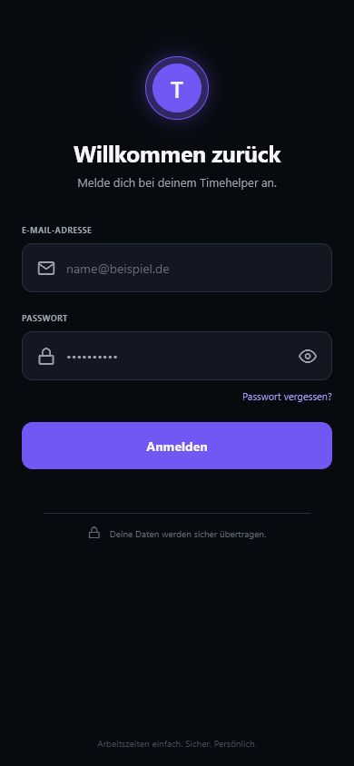
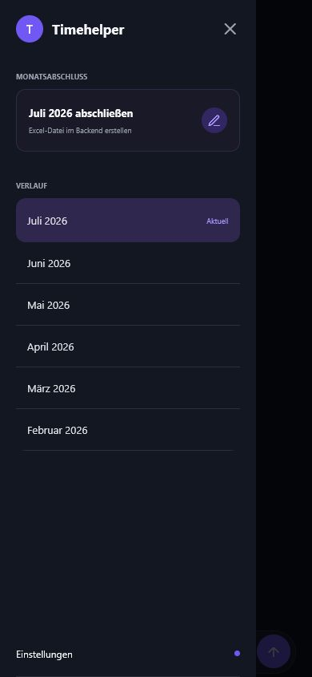
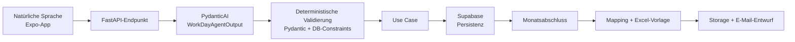

# timeHelper

[](https://github.com/LucianoKutger/timeHelper/actions/workflows/ci.yml)

timeHelper ist eine persönliche Android-App zur Erfassung von Arbeitszeiten in natürlicher Sprache. Die Expo-App sendet einen Text oder eine Spracheingabe an ein FastAPI-Backend. Dort übersetzt PydanticAI die Eingabe in ein typisiertes Datenobjekt; Pydantic-Regeln und Datenbank-Constraints validieren es deterministisch, bevor Supabase persistiert. Ein separater Monatsabschluss überträgt die gespeicherten Daten in eine bestehende Excel-Vorlage und legt einen E-Mail-Entwurf ab.

> **Reifegrad:** persönlicher Prototyp für den Eigengebrauch. Der Stand ist weder als produktionsreif noch als für fremde Arbeitszeitdaten freigegeben zu verstehen.

## Projektstatus

| Bereich | Stand am 31.07.2026 |
| --- | --- |
| Zweck | Persönliches Projekt / Eigengebrauch |
| Eigenanteil | Alleinentwicklung; die Git-Historie enthält einen Autor |
| Entwicklungszeitraum dieses Stands | 18.–23.07.2026 laut Git-Historie |
| Mobile App | Lint und TypeScript-Prüfung erfolgreich; 14/14 Tests erfolgreich |
| Backend | Qualitäts-Gate noch nicht grün: Ruff und mypy melden offene Befunde; pytest brach lokal unter Windows bei der Test-Sammlung in OpenSSL ab |
| CI | GitHub-Actions-Workflow vorhanden; der Badge zeigt den jeweils letzten Lauf |
| Deployment | Render- und EAS-Konfiguration vorhanden; **kein aktives Backend-Deployment ist durch dieses Repository belegt** |

## Screenshots

Die Aufnahmen zeigen lokale Renderings des aktuellen Expo-Quellstands. Sie belegen kein veröffentlichtes App- oder Backend-Deployment.

| Anmeldung | Navigation und Monatsabschluss |
| --- | --- |
|  |  |

## Architektur in Kürze



Das Sprachmodell darf nur das typisierte `WorkDayAgentOutput` erzeugen. Es schreibt weder direkt in die Datenbank noch in Excel. Die nachgelagerte Pydantic-Validierung prüft unter anderem vollständige Zeitblöcke, Reihenfolge, Überlappung sowie die exklusive Verwendung von Arbeitszeiten oder Tagesmarkern. Persistenz und Excel-Erzeugung erfolgen danach in normalen, testbaren Python-Komponenten. Excel ist kein Teil jedes Agentenaufrufs, sondern wird erst beim expliziten Monatsabschluss aus den bereits gespeicherten Einträgen erzeugt.

Mehr Details: [Architektur](docs/architecture.md), [API](docs/api.md), [Deployment](docs/deployment.md) und [Projektstruktur](docs/project-structure.md).

## Repository-Struktur

- `mobile/` – React Native, Expo und TypeScript
- `backend/` – FastAPI, PydanticAI, Supabase- und Excel-Adapter
- `supabase/` – Migrationen und lokale Konfiguration
- `docs/` – Architektur-, API- und Deployment-Dokumentation
- `.github/workflows/ci.yml` – Prüfungen für Mobile und Backend

## Lokal starten

Voraussetzungen: Python 3.13, [uv](https://docs.astral.sh/uv/), Node.js 22 und npm.

```bash
# Backend
cd backend
cp .env.example .env
uv sync --dev --locked
uv run uvicorn app.main:app --reload

# Mobile App in einem zweiten Terminal
cd mobile
cp .env.example .env
npm ci
npm run start
```

Für Android-Emulatoren muss `EXPO_PUBLIC_API_URL_DEV` in der Regel auf `http://10.0.2.2:8000` zeigen; ein physisches Gerät benötigt die LAN-Adresse des Entwicklungsrechners. Reale Secrets gehören ausschließlich in lokale, ignorierte `.env`-Dateien oder in die Secret-Verwaltung des jeweiligen Dienstes.

## Tests und Qualitätsprüfungen

Die CI führt dieselben Kernbefehle aus:

```bash
cd backend
uv sync --dev --frozen
uv run ruff check .
uv run mypy app
uv run pytest

cd ../mobile
npm ci
npm run lint
npm run typecheck
npm test -- --runInBand
```

Der aktuelle Backend-Status ist bewusst sichtbar und verhindert eine Aussage zur Produktionsreife. Vor einem produktiven Einsatz müssen mindestens die Ruff-/mypy-Befunde, der plattformübergreifende pytest-Lauf, Betriebsbeobachtung, Backup/Restore und ein Security-Review geklärt sein.

## Deployment-Realität

`render.yaml` beschreibt einen manuellen Render-Deploy mit `uv`, `pyproject.toml` und `uv.lock`; automatisches Deployment ist deaktiviert. `mobile/eas.json` enthält Profile für Development Build, APK und AAB. Konfigurationsdateien sind jedoch kein Nachweis, dass ein Dienst aktuell erreichbar ist. Eine Live-URL, Deployment-ID oder ein verifizierter Smoke-Test ist im Repository nicht hinterlegt, daher wird hier **kein deployed Backend behauptet**.

## Öffentliche Darstellung

Das Repository ist privat. Für eine spätere Bewerbung oder Fallstudie eignen sich ein kurzes Demo-Video, eine öffentliche Fallstudie mit Architektur und Entscheidungen oder ein reduziertes Showcase-Repository ohne Secrets, personenbezogene Arbeitszeitdaten und proprietäre Excel-Vorlage.
