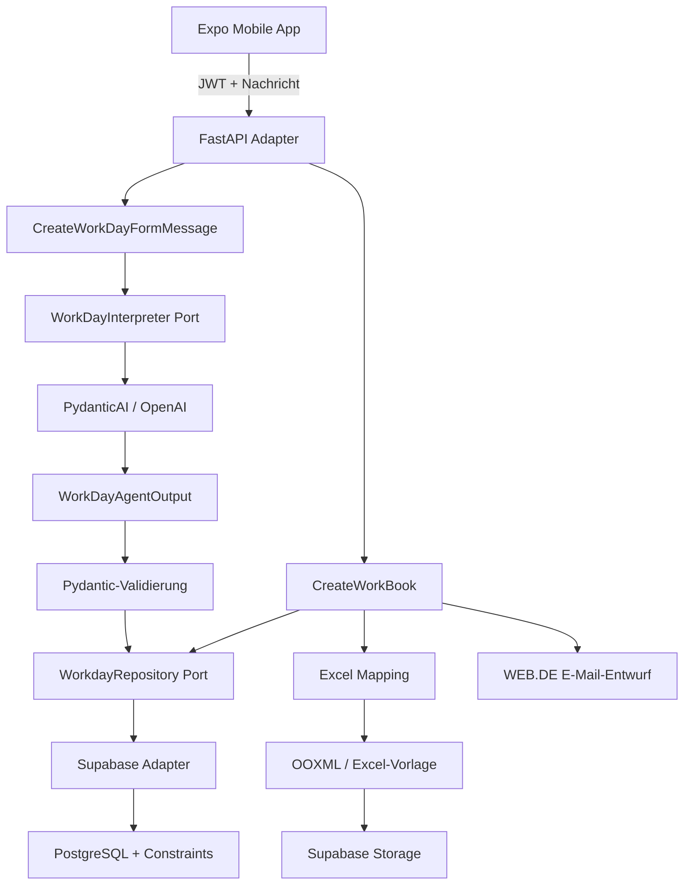

# Architektur

## Überblick

timeHelper ist als kleines Monorepo mit einer mobilen Oberfläche, einem FastAPI-Backend und Supabase als externer Datenhaltung aufgebaut. Das Backend orientiert sich an Ports und Adaptern: Use Cases kennen Protokolle, konkrete Integrationen liegen unter `adapters/outbound`.

## Agentenablauf

1. Die App sendet eine natürliche Nachricht an `POST /v1/workday/`.
2. `PydanticWorkDayInterpreter` ergänzt den aktuellen Datumskontext und ruft den PydanticAI-Agenten auf.
3. Der Agent muss ein `WorkDayAgentOutput` liefern. Freie Tool-Aufrufe oder direkte Schreibzugriffe sind nicht Teil des Agenten.
4. Pydantic validiert das strukturierte Ergebnis deterministisch: vollständige und chronologische Arbeitsblöcke, kein zweiter Block ohne ersten, keine Überlappung sowie entweder Arbeitszeiten oder Tagesmarker.
5. Das Ergebnis wird nochmals als `WorkDayCreate` typisiert und an den Use Case zurückgegeben.
6. Der Supabase-Adapter persistiert den Datensatz. Datenbank-Constraints bilden eine weitere deterministische Grenze; bekannte Konflikte werden in fachliche Fehler übersetzt.
7. Erst ein separater Monatsabschluss lädt persistierte Arbeitstage, mappt sie auf Tabellenzellen, aktualisiert die Excel-Datei, speichert sie und erstellt einen E-Mail-Entwurf.

Damit bleibt die probabilistische Aufgabe auf die Interpretation natürlicher Sprache begrenzt. Validierung, Persistenz und Dateierzeugung sind normaler Python-Code. Der aktuelle Use Case besitzt noch keine Vorschau-/Bestätigungsstufe; die API speichert nach erfolgreicher Interpretation und Validierung direkt.

## Schichten und Verantwortlichkeiten

| Bereich | Verantwortung |
| --- | --- |
| `adapters/inbound/api` | HTTP, Auth-Kontext, Request-/Response-Modelle |
| `core/use_cases` | Orchestrierung von Arbeitstag und Monatsabschluss |
| `core/models` | Fachliche Pydantic-Modelle |
| `core/ports` | Schnittstellen für Interpreter, Repository, Storage, Mapping, Excel und E-Mail |
| `adapters/outbound/pydantic_ai` | Sprachinterpretation und strukturierte Agentenausgabe |
| `adapters/outbound/supabase` | Authentifizierung, Persistenz und Dateiablage |
| `adapters/outbound/excel` | Zellmapping und OOXML-basierte Arbeitsmappen-Erzeugung |
| `adapters/outbound/webde` | Ablage des Monatsabschlusses als E-Mail-Entwurf |

## Grenzen des aktuellen Stands

- Die Backend-Qualitätsprüfungen sind noch nicht vollständig grün.
- Ein aktives Deployment und betriebliche Eigenschaften sind nicht belegt.
- Monitoring, Backup/Restore, Lasttests und Security-Review sind nicht dokumentiert.
- Die App und ihre Abläufe sind auf einen persönlichen Anwendungsfall zugeschnitten.

Aus diesen Gründen wird keine Produktionsreife behauptet.
